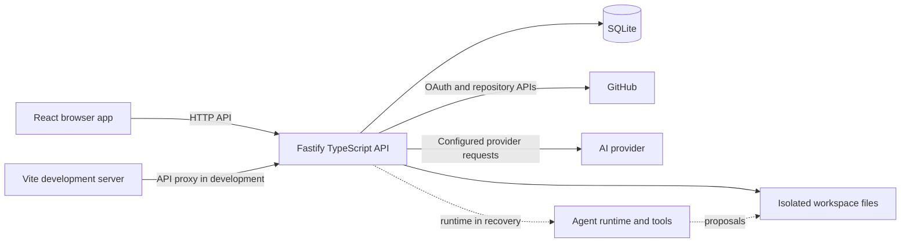
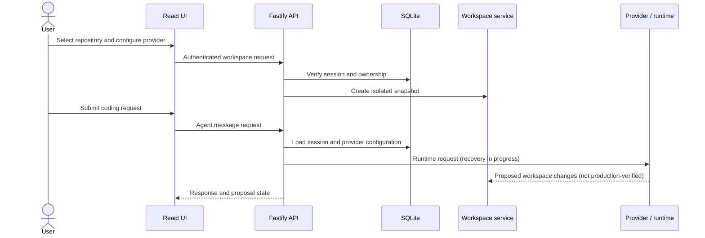
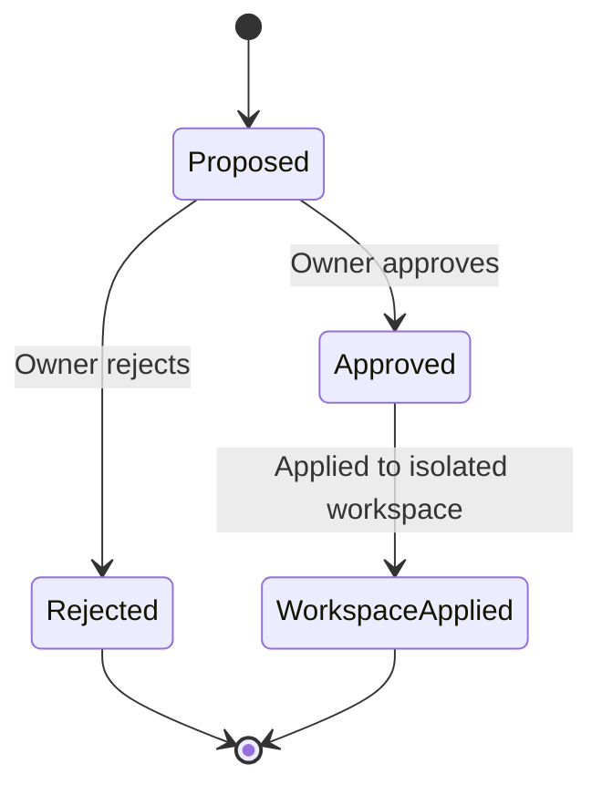

# PocketCode

**An AI-assisted coding workspace, built for the browser.**

PocketCode is an early-development coding platform intended to connect a browser-based workspace with GitHub repositories and AI providers configured by the user. It combines repository browsing, isolated workspaces, and a proposal-oriented editing workflow. The agent runtime is undergoing recovery and is **not verified as production-ready**.

**Status:** Early Development / In Progress  
**Stack:** TypeScript · Fastify · SQLite · React · Vite · Tailwind CSS

## Contents

- [Project overview](#project-overview)
- [Core concept and workflow](#core-concept-and-workflow)
- [Features and status](#features-and-status)
- [Architecture](#architecture)
- [Technology stack](#technology-stack)
- [AI providers and BYOK](#ai-providers-and-byok)
- [Security](#security)
- [Data and persistence](#data-and-persistence)
- [Project structure](#project-structure)
- [Local development](#local-development)
- [Environment variables](#environment-variables)
- [Screenshots and demo](#screenshots-and-demo)
- [Roadmap](#roadmap)
- [Current development status](#current-development-status)
- [Contributing](#contributing)
- [License](#license)

## Project overview

PocketCode is being developed as an AI-powered coding environment accessible through a browser. Its goal is to bring repository context, AI assistance, and reviewable code-change proposals into one workspace rather than treating a coding task as a standalone chatbot exchange.

The project aims to make it easier to work with an existing repository, provide an AI provider credential without sharing it with PocketCode maintainers, inspect changes before accepting them, and keep work organized by user and session. These are project goals; the agent runtime is currently under recovery, so the end-to-end coding workflow is not verified.

## Core concept and workflow

The current UI and backend contain parts of the following workflow. Availability of GitHub-dependent steps requires a configured GitHub App and OAuth application.

1. A user signs in through GitHub.
2. The user selects a repository available to the configured GitHub App and browses its files.
3. After explicit confirmation, PocketCode can create a persistent feature branch for that repository.
4. The user configures an AI provider, model, and API key in settings.
5. The user can start an isolated workspace snapshot and submit a natural-language request.
6. The intended agent inspects files and uses permitted tools; **this step is in recovery and is not production-ready**.
7. Workspace changes are represented as proposals. The UI provides approval and rejection actions.
8. Approved proposals are applied to the isolated workspace. A GitHub commit, push, or pull-request workflow is not currently implemented.

## Features and status

Statuses describe code present in this repository, not a production-readiness guarantee.

| Feature | Description | Status |
|---|---|---|
| Browser frontend | React application with workspace, files, and settings views. | Implemented |
| GitHub sign-in | OAuth/PKCE session flow, with CSRF-aware API actions. | Implemented; requires GitHub configuration |
| GitHub repository browsing | Lists accessible repositories and inspects trees and file contents. | Implemented; requires GitHub App installation |
| Persistent repository branch | Creates a PocketCode branch only after user confirmation. | Implemented; requires repository write permission |
| Workspace snapshots | Creates user/session-associated isolated workspaces from repository snapshots. | Implemented |
| Provider settings / BYOK | Selects a provider and model and stores the user's credential encrypted in SQLite. | Implemented |
| AI provider adapter | Adapts the configured provider to the runtime interface. | Present; end-to-end runtime currently under recovery |
| Agent runtime and tool execution | Intended to process requests and use restricted workspace tools. | In progress; active runtime is damaged and not production-ready |
| File inspection and search | Workspace tools and repository browsing support file-context operations. | Partial; agent execution is not verified |
| Change proposals | Records proposed workspace changes separately from applying them. | Implemented |
| Approval / rejection | Authenticated routes allow a workspace owner to decide a proposal. | Implemented |
| Session and conversation persistence | Database tables and routes exist for agent sessions and messages. | Present; runtime recovery prevents a production-ready claim |
| Provider response streaming | Provider adapter consumes streamed provider responses. | Partial; browser UI does not provide verified token-by-token streaming |
| GitHub commit / push / pull request | Applies approved workspace changes back to GitHub. | Not implemented |
| Secret detection and redaction | Scans workspace content and redacts detected secrets in relevant flows. | Implemented; see [Security](docs/SECURITY.md) for scope |
| Authentication and authorization | Session ownership checks, OAuth/PKCE, CSRF validation, and workspace scoping are present. | Implemented; deployment configuration still matters |

## Architecture

The browser UI calls a Fastify API. The backend uses SQLite for application records, a local workspace area for snapshots and proposed files, GitHub APIs for repository access, and configured AI providers for model requests. The runtime component is shown as in recovery because the checked-in active implementation is not production-ready.



### Request lifecycle



### Proposal lifecycle



See [Architecture](docs/ARCHITECTURE.md) for component boundaries and persistence details.

## Technology stack

Versions below are package manifest ranges unless shown otherwise; they are not claims about every installed environment.

| Technology | Purpose | Version in manifest |
|---|---|---|
| Node.js | Backend and build runtime | `>=22` engine |
| TypeScript | Backend and frontend language | `^5.9.3` |
| Fastify | Backend HTTP server | `^5.12.8` |
| better-sqlite3 | SQLite access | `^12.11.1` |
| React / React DOM | Browser UI | `^18.3.1` |
| Vite | Frontend development and build tool | `^5.4.11` |
| Tailwind CSS | Frontend styling | `^4.0.0` |
| `@cline/llms`, `@cline/sdk` | Provider integrations and CLI agent SDK | `^0.2.0` |

## AI providers and BYOK

The web settings API maps the currently supported provider choices to the provider SDK identifiers and accepts a user-selected model ID. The configured web providers are Gemini, OpenAI, Anthropic, Groq, and OpenRouter. There is no fixed model catalog enforced by the settings route.

Users submit credentials through the authenticated settings flow. The backend encrypts credentials before persisting them in SQLite, does not return the credential value to the browser, and decrypts it server-side when resolving the user's configuration. `TOKEN_ENCRYPTION_KEY` must be a 32-byte key represented by 64 hexadecimal characters for this storage flow.

The separate CLI entry point (`src/index.ts`) also contains environment-variable configuration for Cline, Anthropic, OpenAI, Google, xAI, and Groq. Those CLI variables are distinct from the web app's per-user BYOK settings and should not be mistaken for the web app's supported-provider list.

## Security

The code includes OAuth/PKCE authentication, session ownership checks, CSRF validation for state-changing routes, encrypted provider credentials, workspace path validation, secret-oriented file exclusions and scanning, and restricted tool definitions. These controls do not make an unreviewed deployment safe by default. Keep runtime secrets private, use HTTPS for deployed environments, configure GitHub permissions narrowly, and review the current runtime before exposing it to users.

See [Security documentation](docs/SECURITY.md) for implementation scope and limitations.

## Data and persistence

SQLite is used for user and session records, OAuth state, GitHub connections and installations, provider settings and encrypted credentials, workspaces and workspace files, proposed changes, agent sessions and messages, and repository branch state. Migrations live in [`src/storage/migrations/`](src/storage/migrations/).

The default database location is `data/pocketcode.sqlite`. Local databases and workspace data are excluded from source control; never publish them.

## Project structure

```text
.
├── docs/                 Architecture, security, and development documentation
├── frontend/             React application and Vite configuration
├── scripts/              Repository scripts
├── src/
│   ├── agents/           Agent runtime, provider adapter, and secret scanner
│   ├── auth/             Authentication, GitHub, and provider configuration
│   ├── repositories/     Repository branch workflow
│   ├── server/           Fastify server setup
│   ├── storage/          SQLite connection and migrations
│   └── workspaces/       Workspace and proposal services/routes
└── tests/                Backend tests
```

Local databases, `.env` files, dependencies, generated builds, and runtime recovery artifacts are intentionally omitted.

## Local development

### Prerequisites

- Node.js 22 or later and npm.
- A GitHub OAuth application and GitHub App for the GitHub-backed workflow.
- Credentials for an AI provider supported by the web settings flow, if testing provider configuration.

### Install and configure

```powershell
git clone https://github.com/naveenkullu/PocketCode.git
Set-Location PocketCode
npm install
npm --prefix frontend install
Copy-Item .env.example .env
```

The repository is intended to be private initially. The clone URL above is usable only after the repository has been created and made accessible to you.

Edit `.env` with local GitHub application settings. Do not commit `.env`. For a minimal server start, the GitHub integration can remain unconfigured, but sign-in and repository features require valid GitHub settings. Web AI provider credentials are configured in the app rather than `.env`.

### Run the applications

In separate terminals:

```powershell
npm run dev
npm --prefix frontend run dev
```

The backend defaults to port `3000`; the Vite frontend defaults to port `5173` and proxies API requests to the backend.

### Build and tests

```powershell
npm run build
npm --prefix frontend run build
npm test
```

The current test tree mixes Node's built-in test runner with Vitest imports, while the root `test` script invokes `tsx --test`. As a result, `npm test` is not currently a reliable all-tests command; see [Development](docs/DEVELOPMENT.md) for the known limitation and targeted commands. The agent runtime is not verified by a passing build as production-ready.

## Environment variables

Copy [`.env.example`](.env.example) to `.env` for local server configuration. The example contains no usable credentials.

| Variable | Purpose |
|---|---|
| `NODE_ENV` | Selects development or production behavior. |
| `PORT`, `HOST` | Backend bind port and address. Defaults are `3000` and `127.0.0.1`. |
| `PUBLIC_BASE_URL` | Absolute base URL used by backend integration flows. |
| `FRONTEND_URL` | Frontend origin used by server configuration; defaults to localhost in development. |
| `TOKEN_ENCRYPTION_KEY` | 32-byte hexadecimal key (64 hex characters) for encrypted stored credentials. Keep private. |
| `GITHUB_APP_CLIENT_ID`, `GITHUB_APP_CLIENT_SECRET` | GitHub OAuth client credentials. |
| `GITHUB_APP_SLUG`, `GITHUB_APP_ID`, `GITHUB_APP_PRIVATE_KEY` | GitHub App identity and signing key, used for App API operations. |
| `GITHUB_APP_CALLBACK_URL` | OAuth callback URL; required for GitHub authorization. |
| `GITHUB_APP_SETUP_URL` | Optional GitHub App setup URL. |
| `PROVIDER_ID`, `CLINE_API_KEY`, `ANTHROPIC_API_KEY`, `OPENAI_API_KEY`, `GOOGLE_API_KEY`, `XAI_API_KEY`, `GROQ_API_KEY`, `MODEL_ID`, `XAI_MODEL`, `GROQ_MODEL` | Optional configuration for the separate CLI entry point only; web BYOK credentials are entered through Settings. |

GitHub variables are optional for starting a local server, but required for the associated GitHub features. Detailed setup notes are in [Development](docs/DEVELOPMENT.md).

## Screenshots and demo

No verified screenshots or public demo are included yet.

## Roadmap

### Present in the codebase

- Browser UI, GitHub authentication/repository browsing, and provider settings.
- SQLite persistence, isolated workspace snapshots, and proposal decision routes.
- Secret-scanning and workspace validation components.

### In progress

- Agent runtime recovery and end-to-end validation.
- Aligning test-runner configuration with the mixed test suite.

### Planned

- More reliable and observable agent execution.
- Broader provider support and improved provider configuration.
- Safer repository workflows for applying reviewed changes.
- Improved mobile experience.
- Collaboration and workspace sharing.
- Deployment integrations.

## Current development status

PocketCode is early-stage software. **The active agent runtime is undergoing recovery and has not been verified as production-ready.** Do not rely on it for unattended or production code changes. GitHub workspace proposals currently do not constitute a verified commit, push, or pull-request workflow.

## Contributing

Contributions and issue reports are welcome. Read [CONTRIBUTING.md](CONTRIBUTING.md) and [Development](docs/DEVELOPMENT.md) first. Please include reproduction steps for bugs, avoid sending credentials or private repository contents, and do not claim a behavior is supported without validating it.

## License

No `LICENSE` file is present in the repository. Although the root package manifest contains license metadata, that does not replace a repository license file. Clarify the intended license before redistributing this project.
