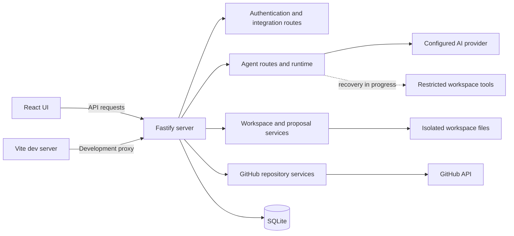
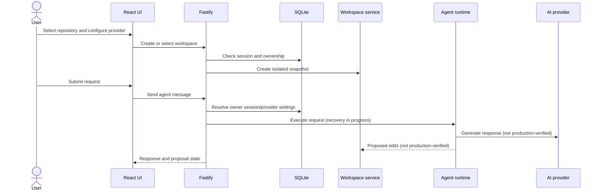
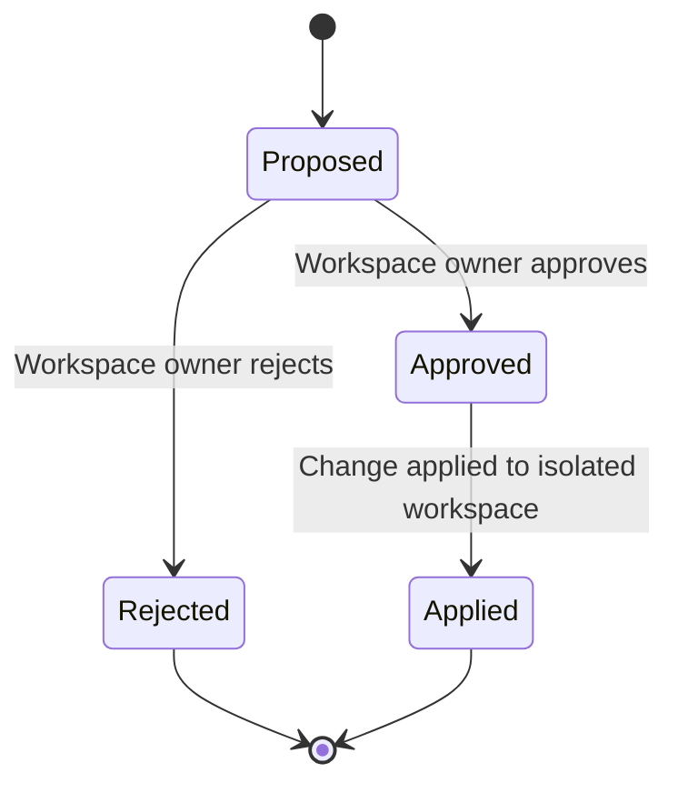

# Architecture

This document describes the current code organization and intended request paths. PocketCode is under active development; in particular, the active agent runtime is undergoing recovery and must not be treated as production-ready.

## Components

- **Frontend:** React UI in `frontend/`, built and served in development by Vite. Its dev server proxies API requests to the backend.
- **Backend:** TypeScript/Fastify server in `src/server/`. It registers authentication, GitHub, provider configuration, workspace, and agent routes.
- **Persistence:** `better-sqlite3` database and versioned migrations in `src/storage/`.
- **Authentication and integrations:** `src/auth/` contains session, OAuth/PKCE, GitHub App/repository, and per-user provider-configuration code.
- **Agent and provider layer:** `src/agents/provider-adapter.ts` adapts provider SDK responses; the active runtime in `src/agents/agent-runtime.ts` is damaged and recovery is in progress.
- **Workspace and proposals:** `src/workspaces/` manages repository snapshots, isolated files, and proposed workspace changes. `src/repositories/` contains persistent GitHub branch provisioning.

## Coding request lifecycle

The route/service structure supports authenticated workspace and agent requests. The following diagram includes the intended agent handoff, which is not currently verified end to end.

## Proposal lifecycle

Proposals are tied to a workspace and user. The approval/rejection API is separate from the generation path. An approval applies a change to the workspace; the repository branch service provisions a branch, but no verified commit, push, or pull-request lifecycle is present.

## Persistence

Migrations reside in `src/storage/migrations/`. Major entities include:

| Entity | Purpose |
|---|---|
| `users`, `sessions`, `oauth_states` | User identity and authenticated browser sessions |
| `github_connections`, `github_installations`, `github_installation_states` | GitHub account and app-installation association |
| `user_ai_provider_settings`, `user_ai_provider_credentials` | Selected provider/model and encrypted per-user credential |
| `workspaces`, `workspace_files`, `workspace_changes` | Snapshot metadata, file state, and proposed changes |
| `agent_sessions`, `agent_messages` | Agent conversation/session records |
| `repository_branches` | Persistent PocketCode branch provisioning and status |

SQLite defaults to `data/pocketcode.sqlite`. Runtime workspace files are stored separately and are local data, not source artifacts.

## Important boundaries

- Frontend requests use the backend API; provider credentials are not supplied to the browser as configuration responses.
- GitHub repository data is retrieved through configured GitHub integration services.
- Workspaces are associated with user and session records; the workspace service validates paths and rejects symlinks.
- Proposal approval applies to the isolated workspace only. It does not publish edits to GitHub.
- The runtime is not currently verified as production-ready. Diagrams that show tool execution or provider interactions describe intended integration, not a readiness guarantee.
